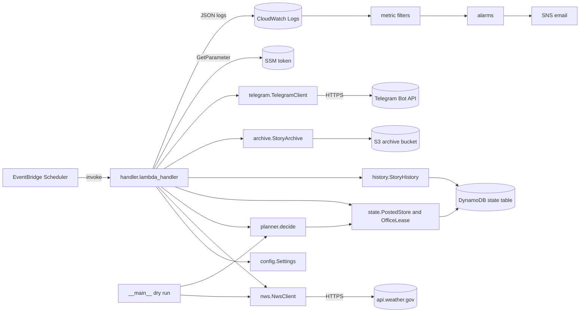
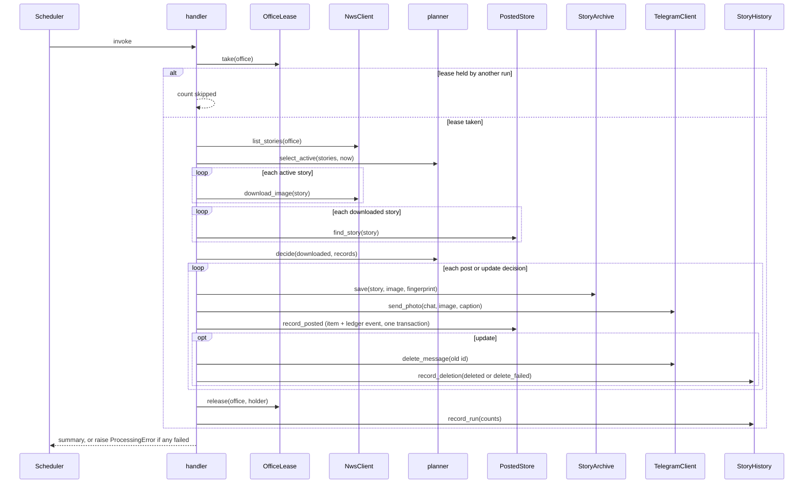
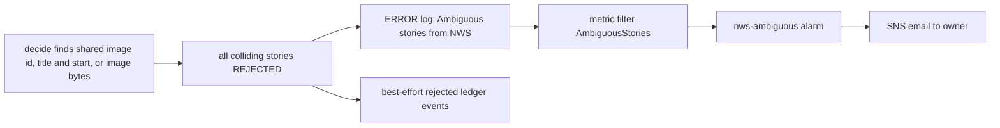
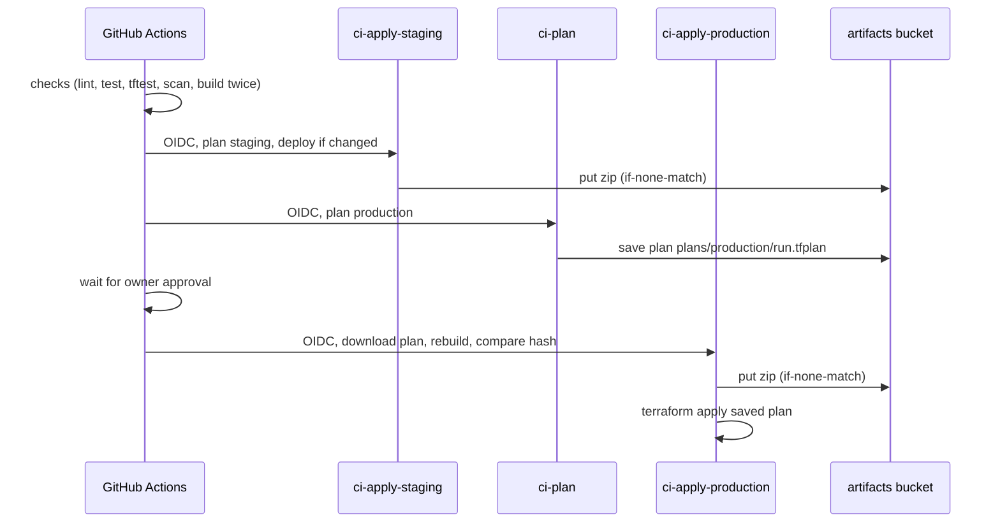

# Architecture: weather-story-bot

## Architecture Analysis

### System Overview

One Python 3.13 Lambda (arm64) on an EventBridge Scheduler `rate(15 minutes)` schedule reads NWS, writes to S3 and DynamoDB, and posts to Telegram. CloudWatch log metric filters and alarms watch it and email through SNS. Two Terraform root modules: the main stack (`infra/`, applied per environment) and the CI-access bootstrap stack (`infra/bootstrap/`, applied by hand). A GitHub Actions pipeline plans pull requests and deploys `main` to staging, then to production after approval.

### Architectural Style

Serverless, scheduled batch worker; a single deployable (one zip, one handler). Inside the package: a pure decision core (`planner.py`, no I/O, no clock) between thin injected-client adapters (`nws.py`, `telegram.py`, `state.py`, `history.py`, `archive.py`) and one orchestrator (`handler.py`). Evidence: `Services` dataclass wiring in `handler._build_services`; planner docstring "No logging, no I/O, no clock of its own".

### Component Relationships

<!-- Text fallback: The scheduler invokes handler.lambda_handler. The handler loads config, then uses the NWS client (api.weather.gov), the pure planner, the state store and lease (DynamoDB), story history (DynamoDB), the archive (S3) and the Telegram client (Telegram Bot API); it reads the bot token from SSM. The dry-run CLI uses only the NWS client and planner. Handler logs flow to CloudWatch Logs, whose metric filters feed alarms that email through SNS. -->

### Data Flow

NWS listing JSON → `Story` dataclasses → split expired/active → images downloaded → current `PostedRecord`s read (strongly consistent) → `Decision`s → for post/update: S3 archive pair → Telegram message → DynamoDB transaction (current-story item + ledger event) → optional delete of the replaced message → best-effort history (deletion event, last-seen, run record). Per-office counts become the invocation's return value and the `Run complete` log line. Keys and item shapes are in [api-documentation.md](api-documentation.md#dynamodb-state-table-contract).

Deployment data flow: source → reproducible `build/lambda.zip` (content-addressed by base64 sha256) → artifacts bucket `<env>/lambda/<hash>.zip` → Lambda `s3_key`; production's saved plan travels through the artifacts bucket, never a GitHub artifact.

### Key Design Decisions

| Decision | Rationale and alternative rejected (from code comments and agent-os standards) |
|---|---|
| Record after send, delete after record | A failure yields a repost, never a miss; the alternative (record first) can lose a story |
| Post record + ledger event in one `TransactWriteItems` | State and history cannot drift; rejected keeping the ledger best-effort (Phase 1.2) |
| Office lease via conditional `PutItem` on `expires_at`, not TTL | Only one run acts per office; TTL deletion is lazy and imprecise |
| Single-table PK/SK, no indexes, no TTL | Access patterns are per office; analytics via S3 export; LSI rejected (10 GB partition cap) |
| No platform retries (Lambda async 0, scheduler 0) | The next scheduled run is the retry; at most one in-client retry |
| Pure planner shared by Lambda and CLI | The dry run previews exactly what the Lambda would decide |
| Content-addressed reproducible zip, plan-then-apply exact saved plan | What was reviewed is what deploys; rollback is a revert |
| Bootstrap stack applied by hand with MFA; per-env permissions boundaries; exact OIDC subjects | The pipeline cannot widen its own permissions |
| Schedule created `DISABLED`, alarms on, both then ignored by Terraform | `start`/`pause` are API operations an apply never undoes |

Security: the Telegram token stays in SSM (never Terraform state), is kept out of logs (httpx loggers raised to WARNING, URLs never in exceptions); IAM is exact-action, tag-conditioned, boundary-limited; public repo means plan-printed variables are `sensitive`.

### Improvement Opportunities

- Finish Phase 2.2: per-office schedules passing the office in the event, a `misconfigured` outcome and alarm, scaled alarm thresholds (bootstrap already allows them).
- Retire the MVP `posted` table and the two finished migration scripts once the soak ends.
- Move the standards' rationale (cited by short name across the code) into an AI-DLC home before removing `agent-os/` (see [code-quality-assessment.md](code-quality-assessment.md#agent-os-coupling)).

## Interaction Diagrams

### Scheduled run for one office (post or update)

<!-- Text fallback: The scheduler invokes the handler, which takes the office lease. If another run holds it the office is counted skipped. Otherwise it lists stories from NWS, drops expired ones, downloads each active image, reads each story's current record, and asks the planner to decide. For each post or update it archives to S3, sends to Telegram, then writes the record and ledger event in one DynamoDB transaction; for an update it deletes the old Telegram message and records a deleted or delete_failed event. It releases the lease, records the run, and returns the summary or raises ProcessingError if anything failed. -->

### Rejection and alerting path

<!-- Text fallback: When decide finds stories sharing an image id, a title and start time, or image bytes, every colliding story is rejected. The handler logs one ERROR "Ambiguous stories from NWS" line and writes best-effort rejected ledger events. The AmbiguousStories metric filter counts the log line and the nws-ambiguous alarm emails the owner through SNS. Rejections do not fail the run. -->

### Deploy from main

<!-- Text fallback: On a push to main, the checks job lints, tests, runs Terraform tests and Checkov, and builds the zip twice to confirm it is reproducible. The staging job assumes ci-apply-staging, plans and deploys if anything changed, uploading the zip to the artifacts bucket. The production plan job assumes ci-plan and saves the plan to the artifacts bucket. After the owner approves, the production job assumes ci-apply-production, downloads the plan, rebuilds and checks the zip hash, uploads the zip and applies the saved plan. -->
