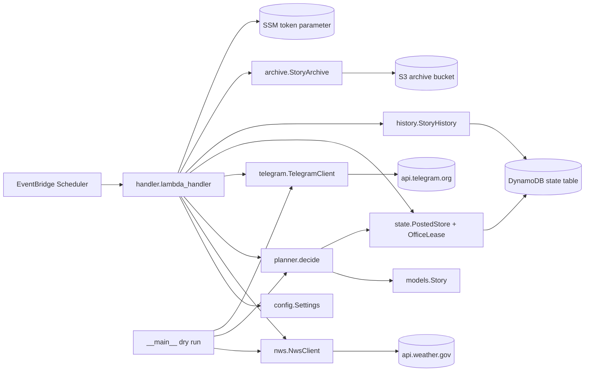
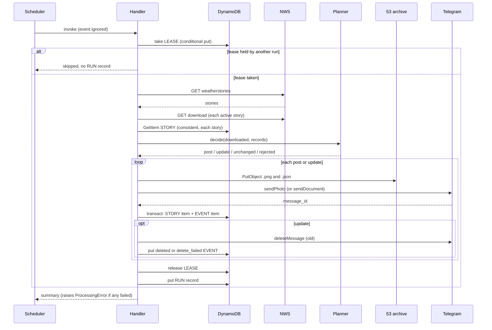
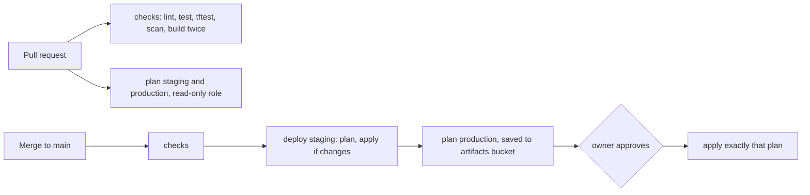

# Architecture

## Architecture Analysis

### System Overview

A serverless, scheduled batch job. EventBridge Scheduler invokes one Python 3.13 arm64 Lambda every 15 minutes. The Lambda loops over the configured offices, and for each one reads NWS, decides per story, then acts on Telegram, S3 and DynamoDB. There is no inbound API and no server; state lives in one DynamoDB table and one S3 bucket per environment.

### Architectural Style

Serverless, single function, with a functional core and an imperative shell. Evidence: `planner.py` is pure (no logging, I/O or clock) and returns `Decision` values; `handler.py` is the only module that performs side effects; clients (`NwsClient`, `TelegramClient`, `PostedStore`, `OfficeLease`, `StoryHistory`, `StoryArchive`) are built once per cold start and injected through the frozen `Services` dataclass.

### Component Relationships

Text fallback: the scheduler calls the handler; the handler reads settings, then uses the NWS client, the pure planner, the Telegram client, the state store and lease, the history writer and the archive; the dry-run CLI reuses only the NWS client, the planner and caption building.

### Data Flow

1. Settings come from five environment variables set by Terraform (`OFFICES_JSON`, `STATE_TABLE`, `ARCHIVE_BUCKET`, `TELEGRAM_TOKEN_PARAM`, `NWS_USER_AGENT`).
2. Per office: take the lease; list stories; split active from expired; download images; read each story's `PostedRecord` (consistent reads); plan; act; release the lease; write a `RUN#` record.
3. Acting on `post` or `update`: archive to S3, send to Telegram, record the revision plus ledger event (one transaction), delete the replaced message, record the deletion event.
4. The DynamoDB data model is detailed in `api-documentation.md`.

### Key Design Decisions

- **Per-office lease** (`state.OfficeLease`) rather than relying on reserved concurrency; concurrency is only a spend ceiling (`infra/lambda.tf`). The lease (360 s) outlasts the Lambda timeout (300 s) and is shorter than the 15-minute schedule.
- **Atomic record plus event** via `transact_write_items`, so a recorded post always has its ledger event.
- **Best-effort history** kept out of `state.py` so observability can never block posting.
- **Frozen hashing encoding** (`_sha256_json`): changing it would change every stored key and repost everything.
- **Log lines as an interface**: metric filters match `"Telegram message sent"` and `"Ambiguous stories from NWS"`.
- **Failure isolation**: per office, per story; any failure raises `ProcessingError` at the end so Lambda records an error and the errors alarm can fire, while rejections do not fail the run.
- **Environment from one root**: `local.production` gates production-only resources (legacy `posted` table, budget); production names stay unsuffixed.
- **Pipeline trust split**: `id-token: write` only on jobs that run no project tests; the bootstrap stack that defines CI roles is applied by hand.
- **Content-addressed deploy**: reproducible zip, key `<env>/lambda/<hash>.zip`, write-once upload, saved plan applied exactly.

### Improvement Opportunities

- Split `handler.py` (logging setup, wiring, orchestration, deletion) into smaller modules.
- Enforce the coupled constants (Lambda timeout, lease duration, schedule interval) with a test or a Terraform validation instead of comments.
- Main infra still creates a single schedule while the bootstrap boundary already allows per-office schedules.
- Remove the legacy `posted` table and migration scripts once the rollback window ends.

## Interaction Diagrams

### One scheduled run for one office

Text fallback: take the lease, list and download, read posted records, decide, then for each post or update archive, send, record atomically and delete the replaced message, finally release the lease and write the run record.

### Deploy path

Text fallback: pull requests run checks and read-only plans; a merge runs checks, deploys staging, saves production's plan, and after approval applies exactly that plan.
