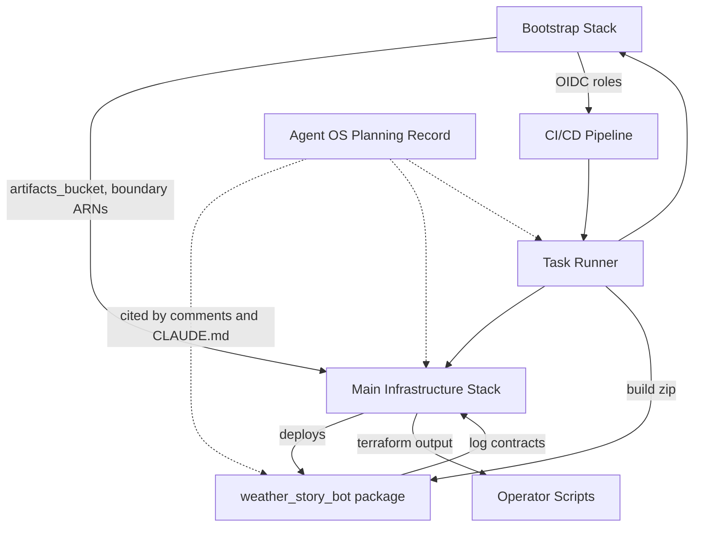

# Dependencies: weather-story-bot

## External Dependencies

### Runtime (shipped in `build/lambda.zip`)

- `httpx` and its transitive set (`httpcore`, `h11`, `anyio`, `certifi`, `idna`). Must ship arm64 manylinux binary wheels (`--only-binary :all:`), or the build fails. boto3 is deliberately not a runtime dependency.

### Development

Listed with versions in [technology-stack.md](technology-stack.md#python-libraries). `tools/checkov/` is a separate uv project because Checkov pins boto3 exactly.

### External Services

| Service | Used by | Failure effect |
|---|---|---|
| api.weather.gov | NWS Client | Office counted failed; run recorded with `nws_failed` |
| Telegram Bot API | Telegram Client | Story counted failed; retried next run (repost acceptable) |
| AWS DynamoDB / S3 / SSM | State Store, Story History, Story Archive, Lambda Handler | Lease/record/archive failures fail the story or office; history failures only warn |
| GitHub OIDC | CI/CD Pipeline | No deploys |

### Out-of-band prerequisites (not in Terraform)

SSM SecureString `/<name>/telegram-token` tagged `Environment=<env>`; S3 Terraform state bucket; per-environment `infra/envs/<env>.backend.hcl` and `<env>.tfvars` (gitignored; CI writes them from secrets); GitHub environments `staging`/`production`, variables `AWS_ACCOUNT_ID`, `AWS_REGION`, `TF_STATE_BUCKET`, secrets `STAGING_TFVARS`, `PRODUCTION_TFVARS`; local AWS profiles `weather-deploy` (MFA) and `readonly`.

## Internal Dependencies

Python module graph: see [code-structure.md](code-structure.md#internal-import-graph). Cross-component dependencies:

<!-- Text fallback: The bootstrap stack provides the artifacts bucket and boundary ARNs to the main stack and the OIDC roles to the pipeline. The task runner drives both stacks and builds the package zip; the pipeline calls the task runner. The main stack deploys the package and feeds Terraform outputs to the operator scripts; the package's log messages are contracts the main stack's metric filters depend on. The agent-os planning record has no runtime dependency but is cited by comments, CLAUDE.md and mise.toml across the package, infra and tasks. -->

## Coupling Constraints to Preserve

- Office id regex in `config.py` and `infra/variables.tf` (and the `???` IAM pattern in `infra/bootstrap/locals.tf`).
- `state.LEASE_DURATION` (360 s) > Lambda timeout (300 s) < schedule interval (900 s).
- Log message text ↔ `infra/monitoring.tf` metric filter patterns.
- `infra/iam.tf` role policy ↔ `infra/bootstrap/apply.tf` boundary policy ↔ `infra/bootstrap/locals.tf` resource name patterns.
- Terraform `required_version` ↔ mise `terraform` range.
- `state.py` key builders ↔ `scripts/migrate_table_keys.py`.
