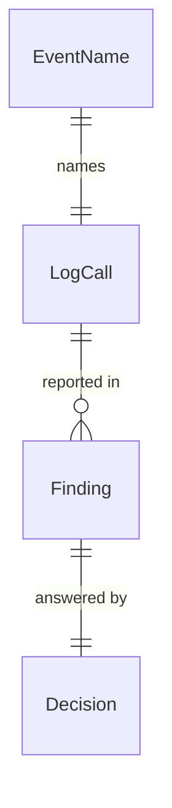

# Functional Spec: u1-logging-review

## Sources

- `inception/units-generation/unit-of-work.md` (U1), `unit-of-work-story-map.md` [FR6.1, FR6.2]
- `inception/requirements-analysis/requirements.md` (FR2, FR5, FR6, NFR5) and `inception/domain-design/decisions.md` (ADR-001 to ADR-005)
- A read of every log call in `src/weather_story_bot/handler.py`, `telegram.py`, `nws.py` and `history.py` (`__main__.py` prints to the terminal and logs nothing; `planner.py`, `state.py`, `archive.py`, `config.py` and `models.py` log nothing)
- `functional-design-questions.md`: Q1 A (no empty-listing warning), Q2 B (slow run becomes a warning), Q3 A (fixed 150 s)

This unit's deliverable is a Markdown document. This spec is the design of that document: what it lists, what it
decides and how U2 carries the decisions out. Code Generation publishes the review as `docs/logging-review.md`
(a new `docs/` folder), with the inventory and the decisions below as its body. It changes no code.

## What the review contains

1. The inventory of every log call (table 1), with level, message, fields and the event name decided for it.
2. The findings (table 2), each with its decision (table 3).
3. The new call (`run.slow`) and the calls deliberately not added.
4. The secrets check (FR6.2).
5. The change list U2 carries out and the names U4 and U5 rely on.

## Workflow

### W1. Writing the review (this unit)

1. List every `logger.*` call in `src/weather_story_bot/` (19 today) with its module, level, message, fields and whether it keeps a stack trace.
2. Give each WARNING and ERROR call, and the message-sent line, an event name by BR1.2 and BR1.3.
3. Compare the calls with BR2.1 to BR2.4 and record each mismatch as a finding with a decision.
4. Run the secrets check against BR3.1 and BR3.2 and record the result per call.
5. Record the two decisions about new warnings (BR4.1, BR4.2).
6. Publish the result as `docs/logging-review.md`. Nothing deploys.

### W2. How U2 carries the review out

1. Move the formatter (components.md; not this unit).
2. For each row of table 1 with an event, add `extra={"event": ...}`; message text stays (BR1.5).
3. Make the field changes of table 3 (D1 to D3) and add L20 (D5).
4. Add the Python test that every WARNING and ERROR call passes an event (BR1.1), that L14 and L08 emit their exact names (BR1.3) and that the Telegram error paths never log the token (BR3.3). Add a `run.slow` test that patches `time.monotonic` and checks that the line appears past 150 s, does not appear at or below 150 s, and comes before "Run complete" when a failed count follows.

### W3. The run.slow check (L20), as U2 builds it

1. `lambda_handler` notes a monotonic start time as its first statement, before the services are built, because a cold start spends part of the 300 s. The Lambda init phase (module import) happens before the handler and is not counted.
2. After `run()` returns, it computes the elapsed seconds.
3. If it is more than 150, it logs "Run was slow" at WARNING with `event` `run.slow`, `duration_seconds` (one decimal) and `threshold_seconds` 150.
4. It then logs "Run complete" and raises `ProcessingError` for failed counts exactly as today.

State: the check has no stored state. If `run()` raises, no run.slow line is written; the `errors` alarm covers that run.

## Table 1. Inventory, with decided event names

| ID | Module | Level | Message (unchanged) | Fields today | Stack | Event decided |
|----|--------|-------|---------------------|--------------|-------|---------------|
| L01 | handler | ERROR | Failed to take office lease | none | yes | `office.lease_failed` |
| L02 | handler | INFO | Office run already in progress | none | no | none (BR1.4) |
| L03 | handler | ERROR | Failed to list stories | none | yes | `nws.list_failed` |
| L04 | handler | ERROR | Failed to process office | none | yes | `office.process_failed` |
| L05 | handler | ERROR | Failed to download story image | title | yes | `nws.image_download_failed` |
| L06 | handler | ERROR | Failed to read posted stories | none | yes | `store.read_failed` |
| L07 | handler | WARNING | Office lease release failed | error | no | `office.lease_release_failed` |
| L08 | handler | ERROR | Ambiguous stories from NWS | stories | no | `nws.ambiguous_stories` (signal) |
| L09 | handler | ERROR | Failed to process story | title | yes | `story.process_failed` |
| L10 | handler | INFO | Story posted | image_id, status, telegram_message_id, archive_prefix, fingerprint, and on an update changes, previous_image_id, previous_fingerprint, previous_archive_prefix | no | none (BR1.4) |
| L11 | handler | WARNING | Telegram delete failed, old message kept | image_id, telegram_message_id, error | no | `telegram.delete_failed` |
| L12 | handler | INFO | Run complete | summary | no | none (BR1.4) |
| L13 | telegram | WARNING | Photo rejected, sending as document | reason | no | `telegram.photo_rejected` |
| L14 | telegram | INFO | Telegram message sent | chat_id, image_filename | no | `telegram.message_sent` (signal) |
| L15 | telegram | INFO | Telegram message deleted | chat_id, message_id | no | none (BR1.4) |
| L16 | telegram | WARNING | Telegram rate limited, retrying | method, retry_after | no | `telegram.rate_limited` |
| L17 | nws | WARNING | NWS request failed, retrying | url, error | no | `nws.retry_transport_error` |
| L18 | nws | WARNING | NWS server error, retrying | url, status | no | `nws.retry_server_error` |
| L19 | history | WARNING | History write failed | history_write, error; three call sites share the one line: `history_write="event"` (plus image_id), `"last_seen"` (plus image_id) and `"run"`. `history_write` tells them apart and is not the `event` field | no | `history.write_failed` (one event for all three) |
| L20 | handler | WARNING | Run was slow (new) | duration_seconds, threshold_seconds | no | `run.slow` |

Counts: 8 WARNING (7 today plus L20), 7 ERROR, 5 INFO. The handler's logger is the fixed name
`weather_story_bot`; the other modules use `weather_story_bot.<module>`.

## Table 2. Findings

| ID | Calls | Category | Finding |
|----|-------|----------|---------|
| F1 | L18, L10 | field | `status` means an HTTP code in L18 and the story's `new` or `updated` in L10. A Logs Insights filter on `status` would mix them. |
| F2 | L07, L11, L13, L17, L19 | field | The exception is under `error` as `str(exc)` in L07, L11 and L19, as `repr(exc)` in L17 and under `reason` in L13. `str()` of many httpx exceptions is empty, so L17's choice is the useful one. |
| F3 | L15, L10, L11 | field | The Telegram message id is `message_id` in L15 and `telegram_message_id` in L10 and L11. |
| F4 | L01 to L19 | coverage | 14 WARNING and ERROR calls and the message-sent line carry no stable kind; three alarms read message text (FR5.1). |
| F5 | L15 | message | "Telegram message deleted" is logged also when Telegram said the message was already gone, which `delete_message` deliberately counts as deleted. The text is accurate enough for its purpose; no change. |
| F6 | all | secret | No call logs the token, a Telegram URL, a caption, an image or a request body. The mechanisms that keep it so are listed below; only the delete-failed path (L11) has a test that proves it today. |
| F7 | handler | consistency | The handler's logger is the fixed name `weather_story_bot`, the others use `__name__`. It matters only for records without an event (third-party loggers), which are kinded by logger name, so no change. |
| F8 | all | coverage | Nothing logs a run that finishes but takes a long time. |
| F9 | L03 | coverage | An empty NWS listing logs nothing. The owner decided that is right (Q1 A). |

## Table 3. Decisions

| ID | Finding | Outcome | Carried out in | Decision |
|----|---------|---------|----------------|----------|
| D1 | F1 | change | u2-log-events | Rename L18's `status` to `http_status` (BR2.2). |
| D2 | F2 | change | u2-log-events | Use `error` = `repr(exc)` in L07, L11, L13 and L19; L13's `reason` becomes `error`; L17 already conforms (BR2.2). The `repr` value includes the exception's class name, so L13's field reads `_PhotoRejectedError('...')`, a private class name; this is accepted, since it is only a label beside Telegram's description. U2 re-checks the tests that read `error`, `reason`, `status` and `message_id` before renaming. |
| D3 | F3 | change | u2-log-events | Rename L15's `message_id` to `telegram_message_id` (BR2.2). |
| D4 | F4 | change | u2-log-events | Add the events of table 1 to every WARNING and ERROR call and to L14 (BR1.1, BR1.3). |
| D5 | F8 | new-call | u2-log-events | Add L20, `run.slow` past 150 s (BR4.1; workflow W3). |
| D6 | F6 | change | u2-log-events | Add the test that the Telegram error paths never log the token (BR3.3). |
| D7 | F5 | keep | none | Leave L15's text as it is. |
| D8 | F7 | keep | none | Leave the logger names as they are; kinds come from events (BR1.1). |
| D9 | F9 | keep | none | No warning for an empty listing (BR4.2). |

## The secrets check (FR6.2)

| Question | Answer from the code | Rule |
|----------|----------------------|------|
| Is the Telegram token in any message or field? | No. `_call` builds the URL with it but never logs the URL; a transport error is re-raised as `TelegramError` with the exception type only and `from None`, so no chained text prints it. | BR3.1 |
| Do `httpx` and `httpcore` log requests? | They log URLs at INFO, which would include the token. `configure_logging` caps both at WARNING. | BR3.1 |
| Does an exception text hold the token? | `TelegramError` messages hold the method, the HTTP code and Telegram's description. NWS and AWS error text holds no secret (the NWS URLs are public). | BR3.1 |
| Is a body, caption or image logged? | No. L08 logs ids, titles and reasons; L10 logs ids and hashes; nothing passes the image or the caption. | BR3.2 |
| Is there a test? | One path: `tests/test_handler.py` asserts the token is not in the log for the delete-failed warning (L11). The transport-error, 429, photo-rejected and unexpected-result paths have none. D6 extends that coverage to them. | BR3.3 |

## Edge cases and corners

- A call that passes a reserved `LogRecord` name raises `KeyError`; BR2.1 forbids it, and the review found none left (`image_filename` was renamed earlier for this).
- A non-JSON-serializable field value is written by `str()` through the formatter's `default=str`; a long value such as L08's `stories` list stays one line.
- A record from a third-party logger (`httpx`, `botocore`, `urllib3`) at WARNING or above has no event; the formatter keeps the logger name (ADR-005, components.md). Not a finding.
- Two events in one invocation (for example `nws.retry_transport_error` then `nws.list_failed`) are separate lines; the warning alarm counts the first, the error-log alarm the second.
- `run.slow` and a failed run in the same invocation both log; the failed run raises after `run.slow` and "Run complete".
- A clock step cannot affect `run.slow`: it uses `time.monotonic`.

## Entity relationships (derived from entities.md)

Text fallback: each Finding names one or more LogCalls and has exactly one Decision; each EventName belongs to one LogCall.

## Rules summary (derived from rules.md)

BR1.1 to BR1.5 give every WARNING, ERROR and the message-sent line a stable event name and keep message text
fixed in U2. BR2.1 to BR2.4 fix the field names, the stack-trace policy and today's levels. BR3.1 to BR3.3 keep
secrets and bodies out of the logs and prove it with a test. BR4.1 adds the slow-run warning and BR4.2 records
that an empty listing stays silent.

## What U2, U4 and U5 take from this

- U2 makes the changes D1 to D6 and keeps message text (BR1.5).
- U4 filters on the two signal names: `telegram.message_sent` (for `quiet` and `repost-loop`) and `nws.ambiguous_stories`.
- U5 counts by `level` and shows kinds from `event`; `run.slow` joins the warning kinds without a change to the dashboard (FR2.1).

## Assumptions & Open Questions

- **A1**: The Lambda timeout stays 300 s (`infra/lambda.tf`); if it changes, the 150 s threshold in BR4.1 is revisited.
- **A2**: Normal runs finish well under 150 s, so `run.slow` rarely fires; the first week on staging will show whether the threshold is right.
- None of the above blocks the next stage.
