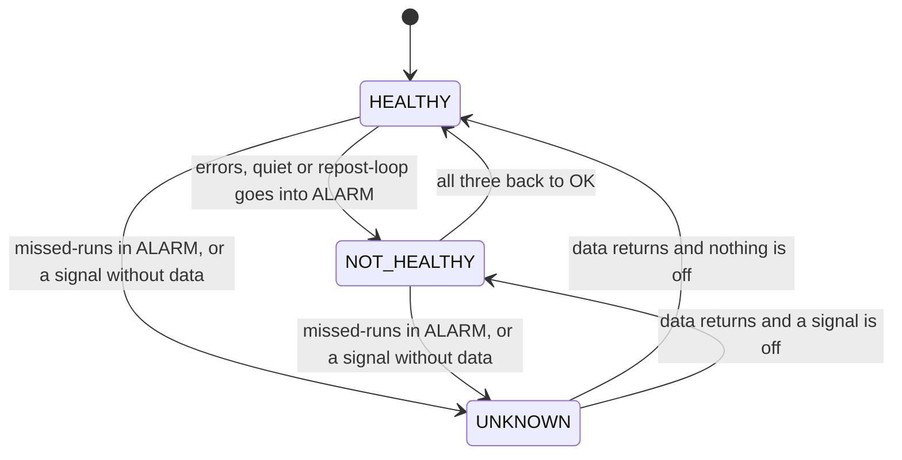
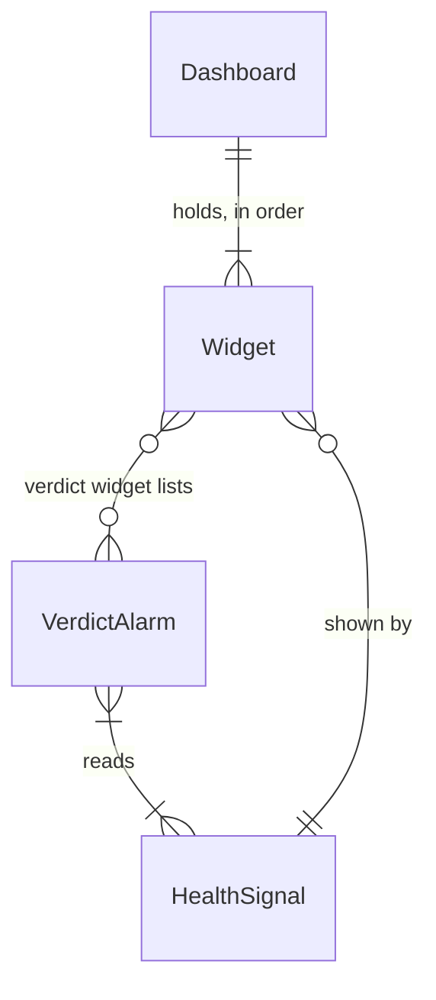

# Functional Spec: u3-health-dashboard

## Sources

- `inception/units-generation/unit-of-work.md` (U3), `unit-of-work-story-map.md` [FR1.1, FR1.2, FR1.3, FR1.5, FR1.6, FR1.7, FR1.8]
- `inception/requirements-analysis/requirements.md` (FR1, FR5.3, NFR1 to NFR3) and `inception/domain-design/components.md` (Monitoring: VerdictAlarm, Dashboard) with `decisions.md` (ADR-004, ADR-006)
- `infra/monitoring.tf` (the five alarms, `local.name`, `local.metric_namespace`) and `scripts/set_run_state.py` (what pause leaves in ALARM)
- `ideation/rough-mockups/wireframes.md` (the page order and its states)
- `functional-design-questions.md`: Q1 A (browser time zone), Q2 A (an idle environment reads UNKNOWN)
- CloudWatch documentation: composite alarm rules, the dashboard body (alarm-status, metric and text widgets, alarm annotations, the `timezone` property)

This unit's deliverable is Terraform in `infra/`: two composite alarms and one dashboard per environment, in a new
file beside `monitoring.tf`. This spec is the design of what the owner sees and how it follows from the alarms.
It changes no Python and no existing alarm.

## What the owner sees

One page, top to bottom, the same order in one column at phone width (BR4.1):

| Order | Widget | Kind | Shows |
|-------|--------|------|-------|
| 1 | title-key | text | The title, and the key to the verdict in words (BR1.4, BR5.1) |
| 2 | verdict | alarm status | The `unknown` and `not-healthy` alarms with their states |
| 3 | signals-off | alarm status, filtered | Only the health alarms in ALARM or INSUFFICIENT_DATA (BR2.2) |
| 4 to 7 | tile-missed-runs, tile-errors, tile-quiet, tile-repost-loop | single value + sparkline | Each signal's value now and its trend (BR2.1) |
| 8 | signals-state | alarm status | All four health alarms with their states, ALARM first (BR2.2) |
| 9 | detail-heading | text | What the charts are, what no line means, how to show Chicago time (BR4.4, BR5.1) |
| 10 to 13 | chart-missed-runs, chart-errors, chart-quiet, chart-repost-loop | alarm graph | Each alarm's metric over the dashboard's range with its threshold (BR3.1) |

U5 adds the totals row to the verdict area and the errors-and-warnings area between the signals and the detail.

### Layout (24-column grid; x, y, width, height)

| Widget | x | y | w | h |
|--------|---|---|---|---|
| title-key | 0 | 0 | 24 | 5 |
| verdict | 0 | 5 | 24 | 3 |
| signals-off | 0 | 8 | 24 | 3 |
| tile-missed-runs | 0 | 11 | 6 | 4 |
| tile-errors | 6 | 11 | 6 | 4 |
| tile-quiet | 12 | 11 | 6 | 4 |
| tile-repost-loop | 18 | 11 | 6 | 4 |
| signals-state | 0 | 15 | 24 | 3 |
| detail-heading | 0 | 18 | 24 | 3 |
| chart-missed-runs | 0 | 21 | 12 | 6 |
| chart-errors | 12 | 21 | 12 | 6 |
| chart-quiet | 0 | 27 | 12 | 6 |
| chart-repost-loop | 12 | 27 | 12 | 6 |

The verdict area (the first three rows) is 11 units tall (BR4.2). A grid unit is roughly 30 px, so the verdict
and the table of states fit in about 350 px, with U5's totals adding up to about 90 px. That size is an
estimate, checked on staging at 1440 x 900 and 390 px (NFR2); if the verdict falls below the fold, the key text
is cut before anything else moves.

### The key text (title-key)

The words are fixed here so a test can check them (BR1.4, BR5.1). The environment is never named (BR4.5):

```
# Weather Story Bot
**Reading the verdict.** UNKNOWN if the `unknown` row is not OK (it wins). Otherwise NOT HEALTHY if the
`not-healthy` row is not OK. Otherwise HEALTHY. Warnings never change it.
**Signals that are off** is empty when all four signals are fine. If the verdict is UNKNOWN, the tiles
below may show 0 because the bot did not report.
```

The detail heading carries: "Each chart is its alarm's own metric with the alarm's threshold. A chart with no
line has no data in this range. Set the time zone control at the top of this page to Local to read times in
Chicago time."

## The health signals

| Signal | Alarm (existing, unchanged) | Tile metric and period | Off when |
|--------|-----------------------------|------------------------|----------|
| Runs on schedule | `missed-runs` | `AWS/Lambda` `Invocations`, Sum, 1 hour | no invocation in the last hour (ALARM) |
| No failed runs | `errors` | `AWS/Lambda` `Errors`, Sum, 15 minutes | failed runs in two 15-minute periods in a row |
| A story posted recently | `quiet` | `StoriesPosted`, Sum, 1 day | nothing posted for `quiet_alarm_days` days |
| No repost loop | `repost-loop` | `StoriesPosted`, Sum, 3 hours | more than `repost_alarm_max_posts` posts in 3 hours |

`StoriesPosted` is in `local.metric_namespace`, so staging reads its own metric and production keeps the original
namespace. The two Lambda metrics carry the `FunctionName` dimension of this environment's function.

## Workflows

### W1. How the verdict follows the alarms (runs by itself, nothing for the owner to do)

1. Each health alarm evaluates its metric as it does today.
2. The `unknown` composite alarm re-evaluates: ALARM if `missed-runs` is in ALARM or any of the four is in INSUFFICIENT_DATA (BR1.2).
3. The `not-healthy` composite alarm re-evaluates: ALARM if `errors`, `quiet` or `repost-loop` is in ALARM (BR1.3).
4. Neither composite sends anything (BR1.1). The page reads their states.

### W2. Reading the page (the owner)

1. Open the dashboard (the console, or the phone browser). The verdict rows are on the first screen.
2. Read the verdict by the key (BR1.4). Anything not OK in the first row is UNKNOWN.
3. If it is not HEALTHY, read "Signals that are off" to see which signals, then the tile and the chart for each.
4. Change the time range at the top to look further back; the page opens on 7 days (BR4.3).

### W3. Building it (this unit, Code Generation)

1. Add `infra/dashboard.tf` with the two composite alarms, their rules built from the alarm resources (BR1.6), and the dashboard body from `jsonencode` of the 13 widgets (BR6.2).
2. Add a Terraform test under `infra/tests/` on the mock provider that checks the rules above (the "violation" line of each).
3. The pipeline plans and applies it: staging first, then production after approval. Nothing here depends on U2, U4 or U5, because it reads today's alarms (unit-of-work).

## Verdict states

The composite alarms' states, read by the key, give four rows; `INSUFFICIENT_DATA` in either row also reads as
"not OK" and so follows the same order (BR1.4):

| `unknown` | `not-healthy` | Reads | Example |
|-----------|---------------|-------|---------|
| OK | OK | HEALTHY | all four signals fine |
| OK | ALARM | NOT HEALTHY | `quiet` in ALARM after 2 days with no post |
| ALARM | OK | UNKNOWN | `missed-runs` in ALARM; or `errors` has no data |
| ALARM | ALARM | UNKNOWN | the schedule is off and `quiet` is also in ALARM; the signals-off list shows both |



Text fallback: HEALTHY and NOT HEALTHY switch on `errors`, `quiet` and `repost-loop`; either can move to UNKNOWN
when `missed-runs` is in ALARM or a signal has no data, and UNKNOWN returns to whichever of the two is true once
data is back.

## Edge cases and corners

- **An idle environment reads UNKNOWN (Q2 A).** `mise run pause` leaves `missed-runs` and `quiet` in ALARM, so staging between tests reads UNKNOWN until an hour after `mise run start`. There is no per-environment setting for it.
- **Just after the deploy.** The four health alarms already exist in both environments and hold their state, so only the two composite alarms are new. Until they have evaluated once, which CloudWatch does within a minute or two, they show INSUFFICIENT_DATA and the key reads that as not OK (A5); nothing is emailed in that time.
- **A signal that is off while the schedule is also off.** Both rows are ALARM; the verdict reads UNKNOWN and the signals-off list names every signal, so nothing is hidden.
- **An isolated failed run.** `errors` needs two 15-minute periods in a row, so one failed run leaves the verdict HEALTHY. This unit keeps today's thresholds (FR5.3); U5's error-log alarm is what turns one logged error into NOT HEALTHY.
- **An ambiguous NWS listing.** The `nws-ambiguous` alarm still emails, but the verdict stays HEALTHY until U5 (BR1.5). This is the one gap between U3 and U5 and is accepted.
- **Zero is not blank.** A tile shows 0 for a count with no events (BR2.1). Zero posts in a day is a true value for `StoriesPosted`; the verdict, not the tile, says whether the bot ran.
- **A signal's alarm renamed or removed.** The rules and widgets are built from the alarm resources, so Terraform refuses a dangling reference (BR1.6).
- **Two composite alarms depending on each other.** Not possible: they refer only to metric alarms.
- **Times.** Charts show the browser's time zone (Q1 A). The `timezone` property takes a fixed offset such as `-0600` and cannot follow daylight saving time, so no widget sets it (BR4.4). Opened from another country, the page shows that country's time.
- **The environment label.** FR1.8 is met by adding no label to the page (BR4.5). CloudWatch prints each alarm's name in the alarm lists, and staging's names end in `-staging`; this is the alarm's own name, not text the page adds.
- **Alarm widgets in single-column order.** The phone layout follows the widget order (y, then x); the tiles stack in the order of BR2.1. This is how the console is understood to reflow the grid, and it is checked on staging at 390 px (NFR2).
- **Dashboard refresh.** The page shows what CloudWatch holds when it loads or refreshes; a "last updated" line was proposed in the wireframes and not carried into the requirements, and stale-page detection beyond `missed-runs` and UNKNOWN is out of scope.
- **Accessibility.** Alarm state is written as a word (ALARM, OK, INSUFFICIENT_DATA) beside its colour, so status never rests on colour alone.

## Entity relationships (derived from entities.md)



Text fallback: the Dashboard holds 13 Widgets in order; each HealthSignal is shown by a tile, a chart and a row in
two lists; each VerdictAlarm reads one or more HealthSignals; the verdict widget lists both VerdictAlarms.

## Rules summary (derived from rules.md)

BR1.1 to BR1.7 define the two action-free composite alarms, the order the verdict is read in, what is left out
of it for now and that the existing alarms are untouched. BR2.1 to BR2.3 set the four tiles and the two lists of
alarm states. BR3.1 draws each chart from its alarm. BR4.1 to BR4.5 fix the layout, the first-screen budget,
the 7-day range, the time zone policy and the name. BR5.1 puts every empty case into words. BR6.1 and BR6.2 keep
the unit to two composite alarms and one dashboard in a new file.

## What U4 and U5 take from this

- U4 changes the two filters behind `quiet`, `repost-loop` and `nws-ambiguous`; it keeps metric names, namespaces and thresholds, so this unit's tiles and charts carry on unchanged. It edits `monitoring.tf`, not `dashboard.tf`.
- U5 appends its error-log alarm to the one list the `not-healthy` rule is built from (BR1.6), adds the totals row inside the verdict area's reserved space (BR4.2), and inserts the errors-and-warnings area between the state list and the detail heading, moving the widgets below it down.

## Assumptions & Open Questions

- **A1** [assumption]: A grid unit is about 30 px tall, so the 11-unit verdict area and U5's 3-unit totals row fit in the first screen at 1440 x 900 and 390 px wide. NFR2 is checked by opening staging at both sizes.
- **A2** [assumption]: The console reflows the 24-column grid into one column in y, then x order at phone width, as FR1.6 expects. Checked on staging at 390 px.
- **A3** [assumption]: An alarm-status widget shows an empty list when no alarm matches its filter, and a metric widget with no data shows an empty chart or "no data"; the key and the detail heading say what each means, so the words do not depend on the console's own wording.
- **A4** [assumption]: Two composite alarms per environment cost about $0.50 a month each and three dashboards a month are free, as ADR-006 estimated. NFR Requirements confirms both from the price list.
- **A5** [assumption]: A composite alarm that cannot be evaluated is shown as INSUFFICIENT_DATA, and the key reads that as "not OK" (UNKNOWN for the first row, NOT HEALTHY for the second), so a broken verdict never reads HEALTHY.
- None of the above blocks the next stage.
