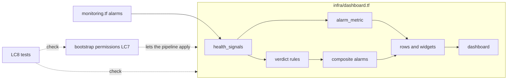

# Logical Components: u3-health-dashboard

## Sources

- `nfr-design/performance-design.md`, `security-design.md`, `scalability-design.md`, `reliability-design.md`, `observability-design.md`
- `functional-design/entities.md` and `functional-spec.md` (HealthSignal, VerdictAlarm, Widget, Dashboard)
- `inception/units-generation/unit-of-work.md` (U4 and U5 build on these)
- `infra/monitoring.tf`, `infra/bootstrap/*.tf`

The unit has no running code. Its components are Terraform locals and resources in `infra/` and one change to the
bootstrap stack. Each is listed with the failure domain it sits in and what a failure of it touches.

## Inventory

| ID | Component | Where | Pattern it carries | Design decision |
|----|-----------|-------|--------------------|-----------------|
| LC1 | Health signal list (`local.health_signals`): alarm, tile title, `fill` flag, in tile order | `infra/dashboard.tf` | One source for tiles, charts and the unknown rule | D-P1, D-P2, D-C2 |
| LC2 | Alarm metric builder (`local.alarm_metric`): namespace, metric, dimensions, statistic and period read from the alarm resource | `infra/dashboard.tf` | Reference, never retype | D-P1, D-P4 |
| LC3 | Verdict rules: `local.unknown_terms`, `local.not_healthy_alarms` and the two rule strings | `infra/dashboard.tf` | Built from resources; extension point for U5 | D-C1, D-C2, D-R5 |
| LC4 | Composite alarms `unknown` and `not-healthy`, no actions, named `local.name-unknown` and `local.name-not-healthy` | `infra/dashboard.tf` | State carrier for the verdict | D-R3, D-R6 |
| LC5 | Row list (`local.dashboard_rows`) with computed x and y, and the widget builders: key, verdict list, signals-off list, tiles, signals-state list, detail heading, charts | `infra/dashboard.tf` | Layout by computation; extension point for U5 | D-P3, D-P5, D-O2, D-O3 |
| LC6 | Dashboard `aws_cloudwatch_dashboard` named `local.name`, body `jsonencode` of LC5 | `infra/dashboard.tf` | One dashboard per environment | D-P7, D-O4 |
| LC7 | Bootstrap permission change: `no_resource_level_writes`, the `dashboards` service, `dashboard` in `names` and `arns`, production's alarm names, `CompositeAlarmWrite` statement | `infra/bootstrap/services.tf`, `locals.tf`, `apply.tf` | Least privilege except one action AWS requires on `*` | D-S1 to D-S5 |
| LC8 | Terraform tests: `infra/tests/dashboard.tftest.hcl` (offline, mock provider) and additions to `infra/bootstrap/tests/*.tftest.hcl` | `infra/tests/`, `infra/bootstrap/tests/` | Fails before apply | D-S6, NFR4.1 |

## Failure domains and blast radius

| Failure of | What it touches | What it does not touch |
|------------|-----------------|------------------------|
| LC6 dashboard (bad body, missing) | The page; the apply fails or the page is blank | The bot, the alarms, the composites, the alerts topic |
| LC4 composite (bad rule, missing) | The verdict states on the page | The five existing alarms and their emails |
| LC1 to LC3, LC5 (a wrong local) | Caught by LC8 before apply; at worst a wrong tile or rule | Anything running in AWS |
| LC7 bootstrap change | The pipeline's ability to apply this unit (and, if over the size limit, the apply of the bootstrap stack itself) | The running bot; roles already applied stay as they are until the owner re-applies |
| The bot's Lambda, table, bucket and schedule | Not touched by any component of this unit | n/a |

## Shared resources

| Resource | Shared with | Rule |
|----------|-------------|------|
| `local.name`, `local.production`, `local.metric_namespace` | the rest of `infra/` | Read only |
| The five existing alarms | U4 (recreates some), U5 (adds two) | Referenced, never edited here (D-R4) |
| `infra/dashboard.tf` | U5 (inserts a row and an area, appends to `not_healthy_alarms`) | Extension points only (D-C1) |
| Apply-role policy size | U4, U5 (each new production alarm name) | 5,000-character budget per group (D-S5) |

## Diagram

Text fallback: the five existing alarms feed the signal list; the list feeds the metric builder, the verdict rules
and the widgets; the rules become the two composite alarms; the composites and the widgets become the dashboard.
The bootstrap permissions let the pipeline apply all of it; the tests check both.
