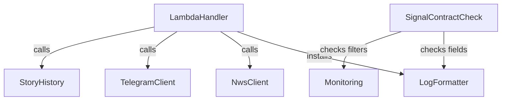

# Components: observability for weather-story-bot

Sources: `inception/requirements-analysis/requirements.md` (FR1 to FR6), the answers in
`domain-design-questions.md` (Q2, Q4, and Q5, which replaced Q1 and Q3 with a lighter design), and the code
knowledge base (`architecture.md`, `component-inventory.md`). This is a brownfield change: three components
are new, the rest already exist and change only where they log or wire logging. Components the change does
not touch (Story Model, Settings, Planner, Posted Store, Office Lease, Story Archive, Dry-Run CLI) are left
out.

```yaml
components:
  - name: LogFormatter
    summary: Writes every log record as one JSON line with stable, machine-read fields, including the event name.
    behaviour: >
      Moves today's JsonFormatter and request-context record factory out of the Lambda Handler, keeping
      today's fields (time, level, logger, message, office, aws_request_id, and the call's extra fields).
      When a call passes extra={"event": "<name>"}, the line carries it as a top-level event field. The
      formatter only writes: it never validates and never raises, so no record is lost. A record at WARNING
      or above with no event (for example from httpx or botocore) is still written with its level and
      logger, and is counted with its logger name as its kind. Alarms and the dashboard read only event,
      level and logger, never message.
    responsibilities:
      - The shape of every log line, including the event field
      - Request and office context on every line
      - Never dropping a record
    depends_on: []
    dependents:
      - component: LambdaHandler
        interaction: installs the formatter on cold start
      - component: SignalContractCheck
        interaction: checks the fields it writes
    external_dependencies:
      - name: CloudWatch Logs
        kind: other
        purpose: the Lambda's log group receives every line
    entities:
      - name: LogLine
        identifier: CloudWatch log event id (@ptr)
        attributes: [time, level, logger, message, event, office, aws_request_id]

  - name: NwsClient
    summary: Existing NWS client; its two retry warnings pass event names.
    behaviour: >
      Unchanged behaviour. The two retry warnings pass extra={"event": ...}.
    responsibilities:
      - Log NWS retries with stable event names
    depends_on: []
    dependents:
      - component: LambdaHandler
        interaction: lists stories and downloads images
    external_dependencies:
      - name: NWS API
        kind: third-party-api
        purpose: story listings and images
    entities: []

  - name: TelegramClient
    summary: Existing Telegram client; its warnings and its message-sent event pass event names.
    behaviour: >
      Unchanged behaviour. The rate-limit and photo-fallback warnings pass event names, and so does the
      message-sent INFO line the quiet and repost-loop signals count.
    responsibilities:
      - Log Telegram warnings and sends with stable event names
    depends_on: []
    dependents:
      - component: LambdaHandler
        interaction: sends and deletes messages
    external_dependencies:
      - name: Telegram Bot API
        kind: third-party-api
        purpose: posting to the channel
    entities: []

  - name: StoryHistory
    summary: Existing best-effort history writer; its write-failure warning passes an event name.
    behaviour: >
      Unchanged behaviour. The history-write warning passes an event name.
    responsibilities:
      - Log history write failures with a stable event name
    depends_on: []
    dependents:
      - component: LambdaHandler
        interaction: records history events and runs
    external_dependencies:
      - name: DynamoDB
        kind: database
        purpose: history items in the state table
    entities: []

  - name: LambdaHandler
    summary: Existing entry point; installs the LogFormatter and passes event names for its warnings and errors.
    behaviour: >
      Unchanged run behaviour (failure isolation, ProcessingError when any failed count is above zero).
      Installs the LogFormatter instead of its own JsonFormatter. Every caught failure, the ambiguous-stories
      error, and the lease and delete warnings pass event names.
    responsibilities:
      - Wire logging on cold start
      - Log orchestration warnings and errors with stable event names
    depends_on:
      - component: LogFormatter
        interaction: installs it on the root logger
        style: sync
      - component: NwsClient
        interaction: lists stories and downloads images
        style: sync
      - component: TelegramClient
        interaction: sends and deletes messages
        style: sync
      - component: StoryHistory
        interaction: records history events and runs
        style: sync
    dependents: []
    external_dependencies: []
    entities: []

  - name: Monitoring
    summary: Terraform in infra/ for the metric filters, alarms, verdict composite alarms and the dashboard.
    behaviour: >
      Metric filters match only event, level or logger fields, never message. The quiet and repost-loop
      alarms move to a filter on the message-sent event, nws-ambiguous to a filter on the ambiguous-stories
      event, each with its threshold unchanged. A warning filter and alarm count every record at WARNING, and
      an error-log filter and alarm count every record at ERROR or CRITICAL (15-minute period, threshold 1).
      Two composite alarms give the verdict, with no actions: unknown (missed-runs in ALARM, or any health
      alarm in INSUFFICIENT_DATA) and not-healthy (errors, quiet, repost-loop or the error-log alarm in
      ALARM). An alarm-status widget shows them at the top of one dashboard per environment, above the signal
      tiles, the errors-and-warnings area (Logs Insights over event, level and logger) and the detail charts.
      Every metric alarm emails the alerts topic on ALARM and OK and joins alarm_names, which start and pause
      toggle.
    responsibilities:
      - Metric filters, alarms, verdict composite alarms and the dashboard for each environment
      - Keeping alarm_names complete
    depends_on: []
    dependents:
      - component: SignalContractCheck
        interaction: checks every filter reads event, level or logger
    external_dependencies:
      - name: CloudWatch (metrics, alarms, composite alarms, dashboards, Logs Insights)
        kind: other
        purpose: hosts the signals, alarms and dashboard
      - name: SNS alerts topic
        kind: queue
        purpose: emails the owner
      - name: Lambda metrics (Errors, Invocations)
        kind: other
        purpose: the errors and missed-runs alarms read them directly
    entities:
      - name: Signal
        identifier: metric_name
        attributes: [metric_name, filter_field, filter_value]
      - name: Alarm
        identifier: alarm_name
        attributes: [alarm_name, metric_name, period, threshold, actions]
        references:
          - entity: Signal
            owned_by: Monitoring
            relationship: each Alarm watches one Signal's metric, or a Lambda metric (errors, missed-runs)
      - name: VerdictAlarm
        identifier: alarm_name
        attributes: [alarm_name, rule, actions]
        references:
          - entity: Alarm
            owned_by: Monitoring
            relationship: each VerdictAlarm combines several Alarms' states
      - name: Dashboard
        identifier: name
        attributes: [name, widgets]
        references:
          - entity: VerdictAlarm
            owned_by: Monitoring
            relationship: the dashboard's top widget shows both VerdictAlarms
          - entity: Alarm
            owned_by: Monitoring
            relationship: each signal tile shows one health Alarm

  - name: SignalContractCheck
    summary: Two small offline tests that fail when the code and the Terraform stop agreeing on a signal.
    behaviour: >
      A Python test checks that every WARNING and ERROR call in src/ passes an event, that the formatter
      writes the event field, and that the code paths for the message-sent and ambiguous-stories events still
      emit those exact names. A Terraform test (mock provider) checks that no metric filter reads $.message,
      that the signal filters use those exact event names, and that alarm_names lists every metric alarm. The
      errors and missed-runs alarms read Lambda metrics and are exempt from the event check.
    responsibilities:
      - Prove no alarm or widget is left without its signal (FR5.2)
    depends_on:
      - component: LogFormatter
        interaction: checks the fields it writes
        style: sync
      - component: Monitoring
        interaction: checks the filters and alarm list
        style: sync
    dependents: []
    external_dependencies: []
    entities: []
```

## Component Diagram



Text fallback: the LambdaHandler installs the LogFormatter and calls the three clients, which pass event
names as they log; Monitoring reads the resulting lines in CloudWatch; SignalContractCheck tests the
formatter and Monitoring.

## Component Summary

| Component | Purpose | Depends On | Dependents | Entities Owned |
|-----------|---------|------------|------------|----------------|
| LogFormatter (new, moved from handler) | JSON line shape with event field | none | LambdaHandler, SignalContractCheck | LogLine |
| NwsClient (existing) | Retry warnings with event names | none | LambdaHandler | none |
| TelegramClient (existing) | Warnings and sent event with names | none | LambdaHandler | none |
| StoryHistory (existing) | Write-failure warning with a name | none | LambdaHandler | none |
| LambdaHandler (existing) | Wires logging; orchestration events | LogFormatter, NwsClient, TelegramClient, StoryHistory | none | none |
| Monitoring (new Terraform) | Filters, alarms, verdict, dashboard | none | SignalContractCheck | Signal, Alarm, VerdictAlarm, Dashboard |
| SignalContractCheck (new tests) | Drift tests | LogFormatter, Monitoring | none | none |

## Entity Ownership

| Entity | Owning Component | Identifier | Attributes | References |
|--------|------------------|------------|------------|------------|
| LogLine | LogFormatter | CloudWatch log event id (@ptr) | time, level, logger, message, event, office, aws_request_id | none |
| Signal | Monitoring | metric_name | metric_name, filter_field, filter_value | none |
| Alarm | Monitoring | alarm_name | alarm_name, metric_name, period, threshold, actions | Signal |
| VerdictAlarm | Monitoring | alarm_name | alarm_name, rule, actions | Alarm |
| Dashboard | Monitoring | name | name, widgets | VerdictAlarm, Alarm |

## External Dependencies

| Component | Dependency | Kind | Purpose |
|-----------|------------|------|---------|
| LogFormatter | CloudWatch Logs | other | receives every log line |
| NwsClient | NWS API | third-party-api | story listings and images |
| TelegramClient | Telegram Bot API | third-party-api | posting |
| StoryHistory | DynamoDB | database | history items |
| Monitoring | CloudWatch | other | metrics, alarms, composite alarms, dashboards, queries |
| Monitoring | SNS alerts topic | queue | emails the owner |
| Monitoring | Lambda metrics | other | errors and missed-runs alarms |

## Rationale

| Component | Why it is a separate building block |
|-----------|-------------------------------------|
| LogFormatter | Distinct concern: the line shape every alarm depends on, separated from the handler's orchestration so it can be tested on its own |
| Monitoring | Distinct lifecycle: Terraform, deployed through the pipeline, owned with today's alarms in `infra/` (Q4) |
| SignalContractCheck | Distinct concern: the proof across Python and Terraform that a signal still has its source (FR5.2) |
| Existing clients and handler | Unchanged boundaries; they only pass event names |

The logging review (FR6.1) is a written document, not a component; its code changes (FR6.3) land in the
components above.

**Alternatives Rejected** (see `decisions.md`): a shared event catalogue with an enum (Q1 A, Q3 A, replaced
by Q5 A), per-module constants (Q1 B), codeless logger-and-level kinds (Q1 C), emitted metrics or a mix (Q2 B,
C), tests that parse Terraform (Q3 B), a separate monitoring Terraform root (Q4 B), and a dashboard-only
verdict without composite alarms.
