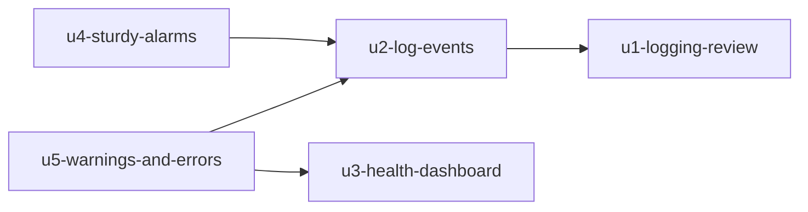

# Unit Dependencies

Sources: `unit-of-work.md`, `inception/domain-design/components.md`. This describes topology only; the
order to build in is chosen later.

## Dependency DAG

- U2 `u2-log-events` depends on U1 `u1-logging-review`: U2 implements the event names, levels and fields the review decides.
- U4 `u4-sturdy-alarms` depends on U2: its filters and its Terraform test match the exact event names U2 emits.
- U5 `u5-warnings-and-errors` depends on U2 (the dashboard's kinds come from the `event` field) and on U3 `u3-health-dashboard` (its area and verdict change sit on U3's dashboard and composite alarm).
- U3 depends on nothing: it is built on today's alarms.



Text fallback: U2 needs U1; U4 needs U2; U5 needs U2 and U3; U3 needs nothing.

```yaml
units:
  - name: u1-logging-review
    kind: spec
    depends_on: []
  - name: u2-log-events
    kind: library
    depends_on: [u1-logging-review]
  - name: u3-health-dashboard
    kind: service
    depends_on: []
  - name: u4-sturdy-alarms
    kind: service
    depends_on: [u2-log-events]
  - name: u5-warnings-and-errors
    kind: service
    depends_on: [u2-log-events, u3-health-dashboard]
```

## Integration Points

| From | To | What crosses |
|------|----|--------------|
| U1 | U2 | The list of event names, levels and field decisions (a document) |
| U2 | U4, U5 | The JSON log line: `event`, `level`, `logger` fields in CloudWatch Logs |
| U3 | U5 | The dashboard resource and the `not-healthy` composite alarm |

## Parallel Development Opportunities

- U1 and U3 have no dependency between them.
- U3 has no dependency on U2 or U4.
- U4 and U5 have no dependency on each other.

## Deployment Constraint

In each environment, U2 must be deployed before U4: U4's moved filters match U2's event names, and
deploying U4 first would leave them matching nothing. U5's warning and error-log alarms count by `level`,
which today's lines already carry, so they work whenever U5 deploys; only its breakdown by kind needs U2's
`event` field to be live.

U4 and U5 do not depend on each other: U4's Terraform test allows any filter on `$.event`, `$.level` or
`$.logger` (never `$.message`), so U5's level filters pass it. Both add to the `alarm_names` list in
`monitoring.tf`, which is the only shared edit.
