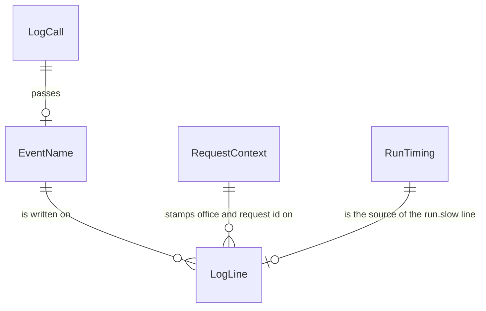

# Functional Spec: u2-log-events

## Sources

- `inception/units-generation/unit-of-work.md` (U2) and `unit-of-work-story-map.md` [FR2.1, FR2.2, FR2.3, FR2.4, FR5.2, FR6.3]
- `inception/requirements-analysis/requirements.md` (FR2, FR5, FR6, NFR4, NFR5) and `inception/domain-design/components.md` (LogFormatter, NwsClient, TelegramClient, StoryHistory, LambdaHandler, SignalContractCheck) [FR2.3]
- `inception/domain-design/decisions.md` (ADR-001, ADR-002, ADR-003, ADR-005) [FR5.2]
- `docs/logging-review.md` (tables 1 to 3, "The run.slow check", "What U2 must build") [FR6.3]
- A read of `src/weather_story_bot/handler.py`, `telegram.py`, `nws.py`, `history.py`, `tests/test_logging_review.py`, and the tests that read log fields (`tests/test_handler.py`, `tests/test_telegram.py`, `tests/test_history.py`)

This unit makes the logs carry what the alarms and dashboard will read, and nothing else changes: every
warning and error says which kind it is, the formatter is its own module and cannot lose a record, a slow run is
logged, and tests stop the code and the Terraform from drifting apart. It builds no alarm and changes no
Terraform, so every alarm keeps matching on message text until U4. This spec is the design the code is built
from; Code Generation writes the code and the tests.

## What the unit builds

| Piece | Component | What it is |
|-------|-----------|-----------|
| 1 | LogFormatter | A new module `src/weather_story_bot/log_format.py` holding the JSON formatter, the request-context record factory and the two context scopes, moved out of `handler.py` (BR1.1 to BR1.5, BR1.7) |
| 2 | LambdaHandler | `handler.py` imports them, keeps `configure_logging` (BR1.6), adds the slow-run check (BR4.1, BR4.2) and its events |
| 3 | NwsClient, TelegramClient, StoryHistory | Their warnings and the message-sent line pass events; three field names change (BR2.1, BR2.2, BR3.1, BR3.2) |
| 4 | SignalContractCheck (Python half) | Drift tests in `tests/` (BR3.3, BR6.1 to BR6.4) and the token-leak test (BR5.1 to BR5.3) |

Proposed homes for the tests (Code Generation's plan settles them): `tests/test_log_format.py` for the
formatter, context scopes, fallback and third-party records (the `JsonFormatter` test now in `test_handler.py`
moves there); `tests/test_logging_review.py` for the call-site checks (BR3.3, BR6.1, BR6.3), since it already
reads `src/` with `ast` and the review's table 1; the signal-path checks (BR6.2) beside the code they exercise
in `test_telegram.py` and `test_handler.py`; the token-leak test (BR5.1 to BR5.3) in its own module
`tests/test_log_secrets.py`, because it drives three modules.

## Workflows

### W1. Formatting a record (LogFormatter)

1. A record reaches a root handler (the bot's own, or any third-party logger's at or above INFO).
2. Build the entry: `time`, `level`, `logger`, `message` first as the base, then add every extra field of the record (everything that is not a standard `LogRecord` attribute), which includes `event`, `office` and `aws_request_id`; then write `time`, `level`, `logger` and `message` again from the record so no extra can replace them (BR1.2); add `exception` when the record has exc_info.
3. Serialise to one line with `json.dumps(..., default=str)` (BR1.1).
4. If any of steps 2 to 3 raises (a circular structure, a message whose arguments do not format, a stack trace that cannot be formatted), build the fallback line instead (BR1.3, BR1.4): `time`, `level`, `logger`, `message` (the formatted message, else the raw message text), `formatter_error` (the exception class name) and, for each that is a plain string, `event`, `office` and `aws_request_id`.
5. If building the fallback raises too, return a line with only `level` and `logger` as strings. Nothing leaves `format()`.

State: the formatter keeps none.

### W2. Setting up logging and request context (LambdaHandler)

1. At import, `log_format` installs the record factory, chained to the one already in place (BR1.7).
2. `lambda_handler` calls `configure_logging()` first on every invocation: add a root handler when none exists; give every root handler the JSON formatter; set the root level to INFO; cap `httpx` and `httpcore` at WARNING (BR1.6). Calling it again changes nothing.
3. `lambda_handler` enters the invocation scope with the Lambda request id; `run()` enters an office scope per office. Each scope restores the previous value when it ends, even on an exception.

Request-context states (the only lifecycle in the unit):

| State | aws_request_id | office | Moves to |
|-------|----------------|--------|----------|
| Outside | unset | unset | Invocation when the handler enters its scope |
| Invocation | set | unset | Office when `run()` enters an office; Outside when the handler's scope ends |
| Office | set | set | Invocation when the office's scope ends (also on an exception) |

A bare `run()` (the tests, the local dry run) starts in Outside and enters Office directly, so its lines carry
`office` and no `aws_request_id`.

### W3. Emitting an event (all clients and the handler)

1. A call at WARNING, ERROR or CRITICAL passes `extra={"event": "<area.what>", ...}`, with the event a string literal from table 1 below (BR2.1). The message text is not touched (BR2.4).
2. The message-sent line (L14) passes `telegram.message_sent`; the ambiguous-stories ERROR (L08) passes `nws.ambiguous_stories` (BR2.2).
3. The formatter writes `event` at the top of the line (W1). Nothing validates the name at run time (ADR-005); the drift tests do (W5).

### W4. The slow-run check (LambdaHandler)

1. `lambda_handler` reads a monotonic clock as its first statement, before `configure_logging` and before the services are built, because a cold start spends part of the 300 seconds. The Lambda init phase (module import) happens before the handler and is not counted.
2. After `run()` returns, it reads the clock again and takes the difference.
3. If the difference is more than 150: log "Run was slow" at WARNING with `event` `run.slow`, `duration_seconds` (rounded to one decimal) and `threshold_seconds` 150 (BR4.1). At exactly 150 or less, log nothing.
4. Log "Run complete", then raise `ProcessingError` for failed counts exactly as today (BR4.2).

State: none is kept. If `run()` raises, step 3 never runs and no slow-run line is written. A run that reaches
the 300-second timeout is killed and logs nothing; the `errors` alarm covers it. The clock is read through a
single module-level name, so the test substitutes it without touching the real `time.monotonic` (A3).

### W5. The Python drift test (SignalContractCheck)

1. Walk every module in `src/weather_story_bot/` with `ast` and collect each call of the form `logger.<level>(...)` (the same walk `tests/test_logging_review.py` already does).
2. For each call at warning, error, exception or critical, and for the message-sent call: read its `extra` argument; require a dict literal with an `"event"` key whose value is a string constant; fail with module, line and message otherwise (BR6.1). Also check every key of any extra dict literal against BR3.3.
3. Compare the set of events found with the set in `docs/logging-review.md` table 1 and fail on any difference (BR6.3).
4. Run the two signal paths for real and compare the captured event with the literal names written in the test (BR6.2).
5. Format records and parse the line: event at the top level; no event for a third-party-named logger; a circular structure gives a parseable fallback (BR6.4).

### W6. The token-leak test

1. Call `configure_logging()`, so `httpx` and `httpcore` records are captured under the cap production uses (BR5.3 reads the two levels back in a separate test).
2. With a recognizable token, drive each handled Telegram failure through respx: a transport error; a 429 then success; a photo rejected then sent as a document; an unexpected result; a delete that fails (through the handler); and an HTTP error status on `sendPhoto`, `sendDocument` and `deleteMessage`.
3. Pass every captured record through the shipped formatter, so fields and exception text are included, and assert the token is in none (BR5.1).
4. Control assertion: the respx route for the token-bearing URL was called (BR5.2).

## Call-site changes

Message text and levels never change (BR2.4). `Event` is the literal to pass; `Field change` is the only change to
the call's other fields.

| ID | File | Message (unchanged) | Event | Field change |
|----|------|---------------------|-------|--------------|
| L01 | handler | Failed to take office lease | `office.lease_failed` | none |
| L03 | handler | Failed to list stories | `nws.list_failed` | none |
| L04 | handler | Failed to process office | `office.process_failed` | none |
| L05 | handler | Failed to download story image | `nws.image_download_failed` | none (keeps `title`) |
| L06 | handler | Failed to read posted stories | `store.read_failed` | none |
| L07 | handler | Office lease release failed | `office.lease_release_failed` | `error` = `repr(exc)` (was `str`) |
| L08 | handler | Ambiguous stories from NWS | `nws.ambiguous_stories` | none (keeps `stories`) |
| L09 | handler | Failed to process story | `story.process_failed` | none (keeps `title`) |
| L11 | handler | Telegram delete failed, old message kept | `telegram.delete_failed` | `error` = `repr(exc)` (was `str`) |
| L13 | telegram | Photo rejected, sending as document | `telegram.photo_rejected` | `reason` becomes `error` = `repr(exc)` |
| L14 | telegram | Telegram message sent | `telegram.message_sent` | none (INFO; the one INFO line with an event) |
| L15 | telegram | Telegram message deleted | none (BR2.3) | `message_id` becomes `telegram_message_id` |
| L16 | telegram | Telegram rate limited, retrying | `telegram.rate_limited` | none |
| L17 | nws | NWS request failed, retrying | `nws.retry_transport_error` | none (already `error` = `repr`) |
| L18 | nws | NWS server error, retrying | `nws.retry_server_error` | `status` becomes `http_status` |
| L19 | history | History write failed | `history.write_failed` | `error` = `repr(exc)` (was `str`); `history_write` stays |
| L20 | handler | Run was slow | `run.slow` | new call: `duration_seconds`, `threshold_seconds` |

L02, L10 and L12 (INFO) are untouched. The comments that today say an alarm's filter matches an exact message
(`handler.py` above L08, `telegram.py` above L14) are updated to say the event is the contract and the message
text is kept until U4 moves the filters.

`docs/logging-review.md`: remove the " (new)" mark from L20's message once the call exists (the existing review
test requires it), and keep the table in step with the code.

Existing tests to re-check before the renames (review decision D2): `tests/test_telegram.py` asserts
`message_id` on the deleted line (L15); `tests/test_handler.py` reads `telegram_message_id` on L11 (already the
final name) and has the `JsonFormatter` test that moves. A grep found no test that reads L13's `reason`, L18's
`status` or the `error` text of L07, L11 and L19 beyond `tests/test_history.py:157`, where
`"ResourceNotFoundException" in record["error"]` still holds under `repr`.

## Edge cases and corners

- **Circular or unserialisable extra**: `default=str` handles a non-serialisable value; a circular structure raises `ValueError`, which becomes the fallback line (W1 step 4) with `formatter_error` `ValueError`.
- **A message whose arguments do not format**: `getMessage()` raises; the fallback line carries the raw message text.
- **An extra named `time`, `level`, `logger` or `exception`**: the formatter's own value wins (BR1.2); the drift test also forbids writing one (BR3.3). `message` and `asctime` cannot be passed at all (logging raises).
- **A non-string `event`** (a dict, a number): written as the JSON value it is, no validation (ADR-005); in a fallback line it is dropped, because only plain strings are kept (BR1.4). The drift test requires a string constant, so this cannot be written in `src/`.
- **A record from a third-party logger** (`httpx`, `botocore`, `urllib3`) at WARNING or above has no event; it is written with its level and logger and is counted by U5 under its logger name.
- **A record logged during module import**, before the first invocation calls `configure_logging`, is written by the Lambda runtime's own handler in its own text format, so it has no JSON `level` field for a filter to read. See open question OQ1. Nothing in this package logs at import.
- **Two events in one invocation** are separate lines (for example `nws.retry_transport_error` then `nws.list_failed`).
- **`run.slow` and a failed run in the same invocation** both log, in the order slow, complete, then the raise (W4).
- **A clock step cannot change `run.slow`**: it reads a monotonic clock.
- **A cold start**: the clock is read before the services are built, so a slow SSM read or client construction counts toward the 150 seconds.
- **A duration that rounds to 150.0** (for example 150.04) is logged, because the comparison uses the unrounded number; the line then reads `150.0`, which is expected.
- **`office` and `aws_request_id`** never appear in an `extra` (logging would raise `KeyError`); `history.py` already says so in a comment, and BR3.3 now enforces it.

## Entity relationships (derived from entities.md)

Text fallback: a LogCall passes at most one EventName, which then appears on the LogLines the call produces; the
RequestContext adds `office` and `aws_request_id` to every LogLine created while it is set; a RunTiming over
150 seconds produces the one `run.slow` LogLine.

## Rules summary (derived from rules.md)

BR1.1 to BR1.7 fix the line: today's fields plus the call's extras, core fields that extras cannot replace, a
formatter that never raises and a fallback that keeps what the alarms read, any logger's records written alike,
setup that formats every root handler, and scoped request context. BR2.1 to BR2.4 put the decided event on every
WARNING, ERROR and CRITICAL call and on the message-sent line, fix the two signal names, and keep message text,
levels and stack traces. BR3.1 to BR3.3 make the field changes of the review (D1 to D3) and forbid names the line
already owns. BR4.1 and BR4.2 add the slow-run warning past 150 seconds. BR5.1 to BR5.3 prove the token never
reaches a log line. BR6.1 to BR6.4 are the Python drift test.

## Traceability to the requirements

| Requirement | Covered by |
|-------------|------------|
| FR2.1 every WARNING is a kind | BR2.1, BR2.2, BR4.1, BR4.2 |
| FR2.2 every ERROR is a kind | BR2.1, BR2.2 |
| FR2.3 a kind does not depend on wording | BR1.1, BR2.1, BR2.4, BR6.3 |
| FR2.4 any logger in the function | BR1.5, BR1.6, BR6.4 (limit: OQ1) |
| FR5.2 Python half of the drift test | BR1.1, BR6.1, BR6.2, BR6.3, BR6.4 |
| FR6.3 the review's code changes | BR1.3, BR1.4, BR2.3, BR3.1, BR3.2, BR3.3, BR4.1, BR4.2, BR5.1, BR5.2, BR5.3 |

No user stories were produced for this intent, so the rows are keyed by requirement (`unit-of-work-story-map.md`).
NFR4 (offline tests, 80% line coverage) applies through the test plan: every test uses respx, moto or no network at
all. NFR5 (what is posted to Telegram does not change) holds because no call's behaviour changes, only what it
logs; BR2.4 and BR4.2 state it.

## Assumptions & Open Questions

- **A1**: The new module is called `log_format.py` and exposes the formatter, the context scopes and the request-id variable under public names; `handler.py` imports them. `configure_logging` stays in `handler.py` because it is the handler's wiring (components.md). *Reason: the name and the split are a code-organisation choice no requirement makes; the tests do not depend on them.*
- **A2**: The fallback line is wider than the review's "minimal record (time, level, logger, message)": it also keeps `event`, `office` and `aws_request_id` when they are plain strings, and adds `formatter_error`. *Reason: the alarms read `event`, so dropping it would silently remove a record from the signal it counts; the phase rule that errors are surfaced, not hidden, asks for the marker. The review's text is its description of the test, not a requirement.*
- **A3**: The slow-run test substitutes a module-level clock name in `handler.py` instead of patching `time.monotonic` for the whole process. *Reason: patching the global would also change what logging, boto and the test runner read; the behaviour the review asks for is the same.*
- **A4**: An extra's `time`, `level`, `logger` and `exception` are overwritten by the formatter's own values (BR1.2). *Reason: no call uses these names, so nothing changes today; it makes the line shape a guarantee the alarms can rely on.*
- **A5**: The Lambda timeout stays 300 seconds and normal runs finish well under 150, so `run.slow` rarely fires; the first week on staging shows whether 150 is right (the review's A1 and A2).
- **OQ1 (for the owner, not blocking)**: FR2.4 says "any record at WARNING or above written by any Python logger in the function". A record logged while the module is imported, before the first invocation's `configure_logging`, is written by the Lambda runtime's handler in plain text, so no alarm or query reads it as a warning. This design does not cover that case: installing the formatter at import would also change logging for every test that imports the handler, and nothing in the package logs at import. Third-party libraries logging a WARNING while they are imported are possible but rare. The option is to call a handler-formatting function at import; the default is to accept the limit and say so in the pull request.
- None of the above blocks the next stage.
